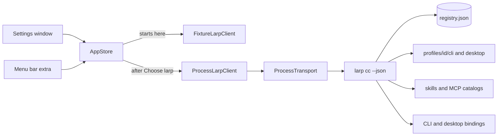
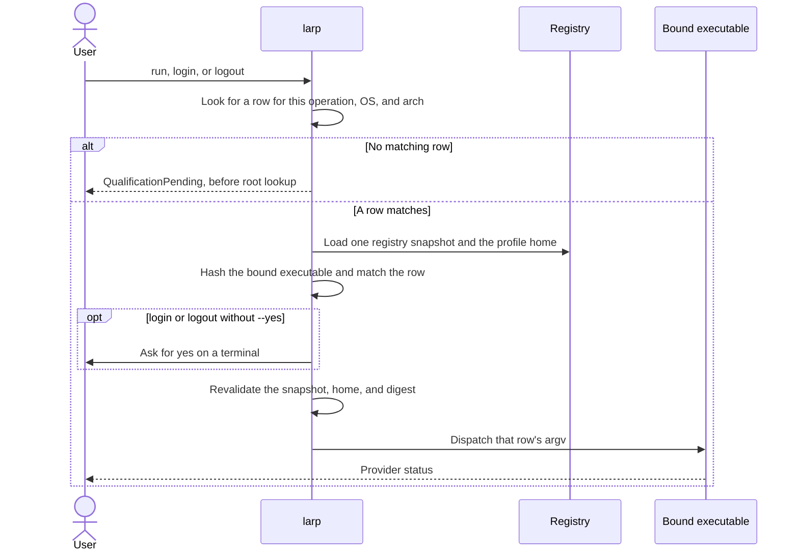
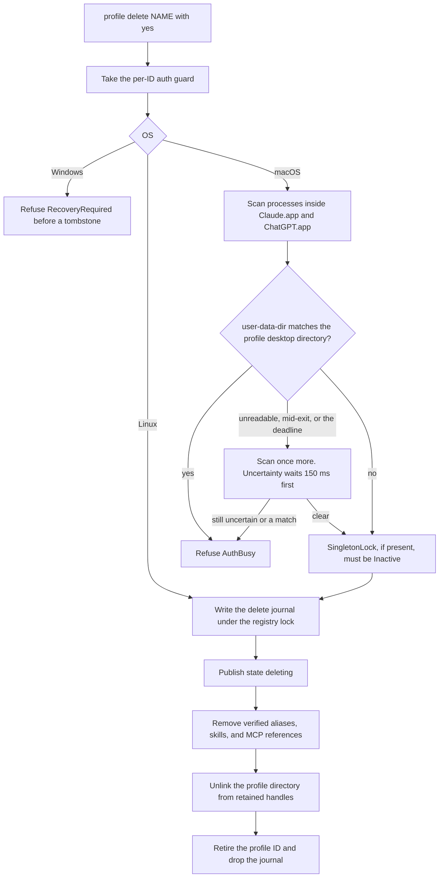

<!-- TODO(owner): logo pending. Expected files: docs/assets/larpcc-banner.svg and docs/assets/larpcc-banner-dark.svg (or .png). Replace this comment with the <picture> block. -->

<h1 align="center">LarpCC</h1>

<p align="center">
  <strong>Run several Claude Code and Codex accounts side by side, each in its own profile, with a native macOS settings app.</strong>
  <br />
  <br />
  <a href="https://github.com/itsmrad/larpcc/issues"><strong>Issues</strong></a>
  &middot;
  <a href="#documentation">Documentation</a>
  &middot;
  <a href="#roadmap">Roadmap</a>
</p>

<p align="center">
  <a href="https://github.com/itsmrad/larpcc/actions/workflows/ci.yml"></a>
  <a href="https://github.com/itsmrad/larpcc/actions/workflows/macos-app.yml"></a>
  
  
</p>

> One person's own accounts only; LarpCC cannot guarantee a provider won't restrict an account.
>
> Use LarpCC only for your own accounts. Separate profiles are a convenience. Do not use them to share or resell accounts. LarpCC cannot guarantee that a provider will not restrict or suspend an account. Use it at your own risk and follow each provider's terms.

LarpCC is independent and is not affiliated with Anthropic or OpenAI.

## Table of contents

- [About the project](#about-the-project)
- [Built with](#built-with)
- [Architecture](#architecture)
- [Engineering facts](#engineering-facts)
- [Getting started](#getting-started)
- [Testing](#testing)
- [Repository structure](#repository-structure)
- [Documentation](#documentation)
- [Roadmap](#roadmap)
- [Contributing](#contributing)
- [Security](#security)
- [License](#license)
- [Acknowledgements](#acknowledgements)

## About the project

LarpCC keeps a named profile for each Claude Code or Codex account you use. A profile is a label plus an immutable numeric ID. The ID chooses the directories. Renaming keeps both the ID and the directory. Forgetting removes the registry record and keeps the directory. Deleting, on Linux and macOS, removes the managed profile directory after a safety scan and an explicit `--yes`.

The repository is a local CLI plus a macOS settings app. The MVP install path is macOS. The CLI also builds on Linux and Windows, with the closed and unsupported cases called out below. There is no hosted service.

What it does today:

- **Profiles, bindings, and surfaces.** [`larp cc profile`](crates/larpcc-cli/src/cli/mod.rs) adds, lists, shows, renames, and forgets profiles for `claude` and `codex`. Each profile has a CLI surface and a desktop surface (`profiles/<id>/cli` and `profiles/<id>/desktop`). [`larp cc provider bind`](crates/larpcc-cli/src/cli/mod.rs) records one absolute native executable per provider. `ok` means the path check passed. Binding does not run the executable, read its version, or qualify an account. See [stage 01](docs/stages/01-profiles.md) and [stage 04](docs/stages/04-layout-and-delete.md).
- **Launch stays closed.** `larp cc run`, `login`, and `logout` call [`admission::invoke`](crates/larpcc-cli/src/launch/admission.rs) with an empty operation table (`ROWS`). They refuse with `provider operation is disabled for this combination` before root lookup, registry access, provider probes, or process creation. Debug, release, installed, and all-features binaries use the same table. `--json` on those commands returns `json_native_io` before root IO. Account sign-in operations stay closed until a reviewed qualification row exists ([stage 03](docs/stages/03-account-qualification.md)).
- **Account status without a provider process.** `larp cc status NAME` reads profile metadata. While [`account::ROWS`](crates/larpcc-cli/src/account/mod.rs) is empty it reports `not_qualified` and does not run the provider. `status NAME --no-account` is the local metadata response, with `native_auth: not_observed`. See [stage 14](docs/stages/14-account-summary.md).
- **Delete, recover, and migrate.** On Linux and macOS, `profile delete NAME --yes` tombstones the profile, removes owned aliases and sharing references, then unlinks the profile directory through retained directory handles ([`delete_profile`](crates/larpcc-cli/src/registry/delete.rs)). `profile recover NAME --yes` resumes an interrupted delete. `profile migrate` moves empty legacy homes to the v3 layout on Linux and macOS. Windows `Profiles::open` returns `RecoveryRequired` before a tombstone or a tree move ([`platform/removal/windows.rs`](crates/larpcc-cli/src/platform/removal/windows.rs)). `--logout` requires a qualified native logout and is refused while that table is empty. Keychain items, remote grants, and Electron Safe Storage can remain after a directory is removed.
- **Aliases.** `larp cc alias` installs a copy of the running `larp` binary under `<data>/bin/NAME`, plus a receipt that pins the data root, profile ID, and surface ([stage 05](docs/stages/05-aliases.md)). Windows creation refuses with `AliasImageUnverified` because the loaded image cannot be verified ([`open_current_larp`](crates/larpcc-cli/src/platform/mod.rs)). An alias still has to pass the same empty launch table, so a CLI alias refuses at qualification. A desktop alias forwards to `app open`.
- **Skills and MCP catalogs.** Explicit skill packages and reference-only MCP server definitions can be shared across active CLI profiles, with per-profile switches ([stage 06](docs/stages/06-skills.md), [stage 07](docs/stages/07-mcp.md)). MCP definitions store command paths and environment-variable names, not secret values. Nothing in the skill importer executes the package.
- **Desktop apps.** On macOS, `larp cc app bind codex /Applications/ChatGPT.app` and `larp cc app open PROFILE` can launch or focus the official ChatGPT.app after signature checks ([`desktop/mod.rs`](crates/larpcc-cli/src/desktop/mod.rs), [stage 09](docs/stages/09-desktop.md)). Claude.app binding and open stay closed. Desktop dispatch on other operating systems returns `QualificationPending`. A dispatch receipt is a local launch or focus result, not a sign-in.
- **Local usage.** `larp cc usage` reads LOCAL limit records on Linux and macOS ([`usage/mod.rs`](crates/larpcc-cli/src/usage/mod.rs), [stage 11](docs/stages/11-usage.md)). LIVE syntax is reserved and returns `live_disabled`. Windows `usage`, usage settings changes, and `profile plan-label` exit 2 with `unsupported` before opening profile files. `settings usage` on Windows shows LOCAL mode and no profile data. Account status on Windows reports `usage: null`.
- **Doctor and JSON.** `larp cc doctor` reports local metadata. `--detect-versions` consults an empty descriptor table ([`provider/version.rs`](crates/larpcc-cli/src/provider/version.rs)), so it does not run a provider. `--json` emits one schema-1 envelope ([`docs/contracts/cli-v1.md`](docs/contracts/cli-v1.md)).
- **macOS app.** [`apps/macos`](apps/macos) is a SwiftUI Settings window and a menu bar extra. It starts in sample mode ([`FixtureLarpClient`](apps/macos/Sources/LarpCC/LarpCCApp.swift)). **General → larp executable → Choose…** switches that session to [`ProcessLarpClient`](apps/macos/Sources/LarpModel/ProcessLarpClient.swift), which runs `larp` with argument arrays and `--json`. The app's `usage` method still returns `commandUnavailable`, so a selected binary does not yet feed the usage views. Sample mode does. Themes are Tahoe, Sequoia, and Sonoma ([`Theme.swift`](apps/macos/Sources/LarpModel/Theme.swift)); Tahoe is drawn on macOS 26 and later.

## Built with

| Area | Technology |
| --- | --- |
| CLI | Rust 1.89 ([`rust-version`](Cargo.toml)), edition 2024, one crate [`larpcc-cli`](crates/larpcc-cli/Cargo.toml) |
| CLI parsing and data | [clap 4.6](https://github.com/clap-rs/clap), serde, serde_json, [sha2](https://github.com/RustCrypto/hashes) |
| Unix / Windows | libc on Unix; [windows-sys 0.61](https://github.com/microsoft/windows-rs) on Windows |
| macOS app | Swift 5.9, SwiftUI, AppKit, macOS 14+ ([`Package.swift`](apps/macos/Package.swift)). No third-party Swift packages |
| App boundary | Schema 1 JSON over a subprocess ([`cli-v1.md`](docs/contracts/cli-v1.md)) |
| Tests | `cargo test`, XCTest (`swift test` in [`apps/macos`](apps/macos)) |
| CI | [`.github/workflows/ci.yml`](.github/workflows/ci.yml) (`native` on Ubuntu, macOS, and Windows, plus `msrv` on Rust 1.89), [macOS App](.github/workflows/macos-app.yml), [macOS Snapshots](.github/workflows/macos-snapshots.yml) |

## Architecture

### App, CLI, and profile homes

The settings window and the menu bar extra share one `AppStore`. Sample mode never starts `larp`. After you choose a `larp` binary, the app sends argv arrays (no shell string) and decodes one schema-1 envelope per call. The CLI is the only writer of the registry, catalogs, and profile directories.



`ProcessLarpClient` is [`apps/macos/Sources/LarpModel/ProcessLarpClient.swift`](apps/macos/Sources/LarpModel/ProcessLarpClient.swift). Registry layout is [`docs/stages/04-layout-and-delete.md`](docs/stages/04-layout-and-delete.md).

### Launch admission

Ordinary `run`, `login`, and `logout` stop at the first box while `admission::ROWS` is empty. The later steps run only when a reviewed row matches this OS, architecture, operation, and executable digest. Synthetic tests inject invented rows into the same functions. They are not the installed `larp` binary.



`status NAME` is a different path. It opens the registry, and with an empty `account::ROWS` it returns `not_qualified` without calling `dispatch`. Desktop `app open` uses [`desktop::open_target`](crates/larpcc-cli/src/desktop/mod.rs): macOS only, and only unmodified `/Applications/ChatGPT.app`.

### Delete safety scan

`profile delete` on macOS scans the current user's processes before it publishes a tombstone. It considers executables inside `Claude.app` or `ChatGPT.app`, checks the vendor signature, and reads argv only to look for `--user-data-dir`. A match against the profile's desktop directory refuses the delete. Uncertainty waits 150 ms and scans once more. Each scan has a two-second deadline. Linux skips that process scan. Windows refuses when profile-tree handles are opened, before a tombstone.



The scan is [`delete/activity.rs`](crates/larpcc-cli/src/registry/delete/activity.rs). The transaction is [`delete.rs`](crates/larpcc-cli/src/registry/delete.rs) and [stage 04](docs/stages/04-layout-and-delete.md#delete-transaction-and-confined-removal). Close sessions you started outside Larp, including ones that set the provider home themselves, before you confirm. The scan is local hygiene. It is not a claim that every same-user process is visible or stopped.

## Engineering facts

A snapshot of git-tracked files at commit `e6aa0d44ae2de606f401bedb741f93d84897d9e4` (2026-11-24). These numbers drift as the code changes. Regenerate them with the commands under the table.

The delete-scan diagram and the stage notes describe main at that commit. Open pull requests may change them.

| Metric | Value |
| --- | --- |
| Rust files that contain `#[test]` | 58 |
| Rust `#[test]` functions | 388 |
| Swift test files (`apps/macos/Tests`) | 7 |
| Swift test methods (`func test…`) | 49 |
| Workspace crates | 1 (`larpcc-cli`) |
| Stage documents (`docs/stages`) | 13 |
| CI workflow jobs | `native` (Ubuntu, macOS, Windows) and `msrv` (Rust 1.89) |
| macOS workflow jobs | `native-app`, `snapshots` |
| Rust lines in `crates/larpcc-cli/src` | 28,801 |
| Rust lines in `crates/larpcc-cli/tests` | 11,436 |
| Swift lines in `apps/macos/Sources` | 5,585 |
| Swift lines in `apps/macos/Tests` | 860 |
| Shell lines in `scripts` | 353 |
| Shell lines in `apps/macos/scripts` | 163 |

`crates/larpcc-cli/src` includes inline tests. The line counts are `wc -l` on git-tracked `.rs`, `.swift`, and `.sh` files.

<details>
<summary>How these numbers were computed</summary>

Run from the repository root at commit `e6aa0d44ae2de606f401bedb741f93d84897d9e4` (2026-11-24). Counts include only files tracked by git.

```bash
git rev-parse HEAD
git log -1 --format='%cs'

git ls-files '*.rs' | while read -r f; do
  grep -qE '^[[:space:]]*#\[test\]' "$f" && echo "$f"
done | wc -l

git ls-files '*.rs' | xargs grep -hcE '^[[:space:]]*#\[test\]' | awk '{s+=$1} END {print s}'

git ls-files 'apps/macos/Tests/**/*.swift' | wc -l
git ls-files 'apps/macos/Tests/**/*.swift' \
  | xargs grep -hcE '^[[:space:]]*func test[A-Za-z0-9_]*\(' | awk '{s+=$1} END {print s}'

git ls-files 'crates/*/Cargo.toml' | wc -l
git ls-files 'docs/stages/*.md' | wc -l

for a in crates/larpcc-cli/src crates/larpcc-cli/tests apps/macos/Sources apps/macos/Tests apps/macos/scripts scripts; do
  git ls-files "$a" | grep -E '\.(rs|swift|sh)$' | xargs wc -l | tail -1
done
```

CI job names are the keys under `jobs:` in [`.github/workflows/ci.yml`](.github/workflows/ci.yml), [`.github/workflows/macos-app.yml`](.github/workflows/macos-app.yml), and [`.github/workflows/macos-snapshots.yml`](.github/workflows/macos-snapshots.yml).

</details>

## Getting started

### Prerequisites

- macOS 14 or newer for the app and [`scripts/install-macos.sh`](scripts/install-macos.sh)
- Rust 1.89 or newer (`rust-version` in [`Cargo.toml`](Cargo.toml))
- Apple's Swift build tools, Swift 5.9 or newer, to build the app ([`Package.swift`](apps/macos/Package.swift))

The CLI crate itself builds on Linux and Windows. Profile-tree delete, legacy migration, desktop app open, and `usage` are not available on every OS. See [Command behavior](docs/cli-reference.md#command-behavior).

### Install on macOS (local, unsigned)

From the repository root, preview and run the installer.

```sh
./scripts/install-macos.sh --dry-run
./scripts/install-macos.sh
```

The installer uses `~/.local/bin/larp` and `~/Applications/LarpCC.app`.
Use `--prefix /absolute/path/to/bin` to choose another directory for `larp`. The
installation paths must be free of symlinks. The installer recognizes a previous
`larp` by its matching SHA-256 extended attribute. To replace any other file
named `larp`, move it aside or explicitly pass `--replace`. The installer keeps
every replaced binary and app in timestamped backup directories beside the
install targets. It verifies both installed targets before reporting success
and prints the backup paths even if verification fails. Move those directories
to the Trash when you no longer need them.

Add the chosen directory to `PATH` if needed. In LarpCC, use **General → larp
executable → Choose…** to select the installed binary.

To build and install manually with the default paths, run these commands from
the repository root.

```sh
cargo build --release --locked --bin larp --target-dir "$PWD/target"
./apps/macos/scripts/bundle.sh
mkdir -p -m 0755 "$HOME/.local/bin" "$HOME/Applications"
```

For a manual upgrade, move the existing `larp` aside first. The following
commands require an unused destination and mark the new binary for future
installer upgrades.

```sh
larp_bin="$HOME/.local/bin/larp"
test ! -e "$larp_bin" && test ! -L "$larp_bin" &&
  install -m 0755 target/release/larp "$larp_bin" &&
  larp_hash=$(shasum -a 256 < "$larp_bin") &&
  xattr -w dev.larpcc.installer.sha256 "${larp_hash%% *}" "$larp_bin"
```

Quit any running LarpCC settings app. If you already installed LarpCC, move the
old `~/Applications/LarpCC.app` to the Trash in Finder. Then copy the new bundle.

```sh
ditto apps/macos/dist/LarpCC.app "$HOME/Applications/LarpCC.app"
export PATH="$HOME/.local/bin:$PATH"
```

If macOS blocks your self-built unsigned app due to quarantine, you can clear
the quarantine attribute for that bundle.

```sh
xattr -dr com.apple.quarantine "$HOME/Applications/LarpCC.app"
```

### Known limitations

The installer assumes no other process modifies the install destinations while
it runs. Wait for the installer to finish before moving, editing, or replacing
either target or its parent directory.

### Uninstall

Quit LarpCC. Remove the `larp` file you installed from your chosen prefix and
move the installed `~/Applications/LarpCC.app` to the Trash. Keep the profile data
directory (`LARPCC_HOME` or `~/Library/Application Support/larpcc`).

### Command-line use

Requires Rust 1.89 or newer. `larp cc <command> --help` lists each command.

```sh
cargo build --release --locked --bin larp
cargo install --path crates/larpcc-cli --locked --bin larp
larp --version
larp cc --help
larp cc profile add work --provider claude
larp cc profile list
larp cc provider --help
larp cc skills --help
larp cc alias --help
larp cc usage
larp cc doctor
larp cc status work --no-account
```

Examples, exit codes, the data root, and the rest of the command behavior are in [the CLI reference](docs/cli-reference.md).

## Testing

| Layer | Tool | Where | Run |
| --- | --- | --- | --- |
| CLI unit and integration | `cargo test` | `crates/larpcc-cli` | `cargo test --workspace --locked` |
| CLI MSRV | Rust 1.89 | same | `cargo +1.89 test --workspace --locked` |
| Synthetic admission | `synthetic-launch` | nonpackaged `larpcc-synthetic` and fakes | [CLI reference](docs/cli-reference.md#command-behavior) |
| macOS model and UI | XCTest | [`apps/macos/Tests`](apps/macos/Tests) | `swift test` from `apps/macos` |
| Unsigned app bundle | `bundle.sh` | [`apps/macos/scripts/bundle.sh`](apps/macos/scripts/bundle.sh) | `./apps/macos/scripts/bundle.sh` |
| Manual Mac checklist | the guide | [`docs/mvp-test-guide.md`](docs/mvp-test-guide.md) | only after a lead fills the handoff |

CI ([`.github/workflows/ci.yml`](.github/workflows/ci.yml)) runs fmt (Linux), clippy, tests, a release build of `larp`, the all-features gate test, and the synthetic-launch tests on Ubuntu, macOS, and Windows. The `msrv` job runs the workspace tests, the stage checks, and the synthetic-launch tests on Ubuntu with Rust 1.89. Formatting, Clippy, and the release build stay on the `native` job. [macOS App](.github/workflows/macos-app.yml) compares the bundled JSON schema with [`docs/contracts`](docs/contracts), runs `swift test`, and builds an unsigned bundle when the app or the contract changes. [macOS Snapshots](.github/workflows/macos-snapshots.yml) renders sample-data pages on macOS 26. It does not sign in to a provider.

[`docs/mvp-test-guide.md`](docs/mvp-test-guide.md) is a human checklist for two disposable profiles. It starts only after the test handoff names an approved build. In this tree, `run`, `login`, and `logout` still refuse because the qualification table is empty.

## Repository structure

```text
.
├── crates/larpcc-cli/          # the larp binary
│   └── src/
│       ├── cli/                # clap grammar, JSON, doctor
│       ├── launch/             # admission; ROWS is empty
│       ├── registry/           # profiles, aliases, delete, migrate
│       ├── share/              # skills and MCP catalogs
│       ├── usage/              # LOCAL usage; LIVE disabled
│       ├── desktop/            # ChatGPT.app on macOS; Claude.app closed
│       ├── account/            # status; account ROWS is empty
│       └── platform/           # Unix and Windows filesystem checks
├── apps/macos/                 # SwiftUI Settings app and menu bar extra
│   ├── Sources/LarpCC/         # windows, pages, themes
│   ├── Sources/LarpModel/      # JSON client and process bridge
│   └── Tests/                  # XCTest
├── scripts/install-macos.sh    # local unsigned install
├── docs/
│   ├── cli-reference.md        # command examples and behavior
│   ├── stages/                 # stage contracts 01–11, 13, 14
│   └── contracts/              # CLI JSON schema and threat review
├── plan.md                     # current plan and historical context
└── .github/workflows/          # ci.yml, macos-app.yml, macos-snapshots.yml
```

## Documentation

| Document | Contents |
| --- | --- |
| [docs/cli-reference.md](docs/cli-reference.md) | Command examples, exit codes, data root, and command behavior |
| [plan.md](plan.md) | Current requirements, the usage exception, and slice order |
| [docs/contracts/cli-v1.md](docs/contracts/cli-v1.md) | Schema-1 JSON envelopes the app decodes |
| [docs/contracts/cli-v1.schema.json](docs/contracts/cli-v1.schema.json) | JSON Schema for those envelopes |
| [docs/contracts/threats.md](docs/contracts/threats.md) | Threat review for delete, MCP, desktop, and remote |
| [docs/stages/01-profiles.md](docs/stages/01-profiles.md) | Profile records and the data root |
| [docs/stages/02-native-launch.md](docs/stages/02-native-launch.md) | Native path and permission checks |
| [docs/stages/03-account-qualification.md](docs/stages/03-account-qualification.md) | Empty qualification table for run, login, and logout |
| [docs/stages/04-layout-and-delete.md](docs/stages/04-layout-and-delete.md) | v3 layout, migrate, delete, and recover |
| [docs/stages/05-aliases.md](docs/stages/05-aliases.md) | Alias launchers and receipts |
| [docs/stages/06-skills.md](docs/stages/06-skills.md) | Shared skill packages |
| [docs/stages/07-mcp.md](docs/stages/07-mcp.md) | Reference-only MCP catalog |
| [docs/stages/08-json-launch-doctor.md](docs/stages/08-json-launch-doctor.md) | JSON, doctor, and version probes |
| [docs/stages/09-desktop.md](docs/stages/09-desktop.md) | macOS ChatGPT.app dispatch |
| [docs/stages/10-native-gui.md](docs/stages/10-native-gui.md) | SwiftUI consumer of CLI JSON |
| [docs/stages/11-usage.md](docs/stages/11-usage.md) | LOCAL usage, disabled LIVE, Windows refusal |
| [docs/stages/13-remote-hosts.md](docs/stages/13-remote-hosts.md) | SSH hosts; contract only in this tree |
| [docs/stages/14-account-summary.md](docs/stages/14-account-summary.md) | Status email and plan, once a row exists |
| [docs/mvp-test-guide.md](docs/mvp-test-guide.md) | Manual Mac test, after a filled handoff |
| [apps/macos/README.md](apps/macos/README.md) | Sample mode, page list, and how the app selects `larp` |

## Roadmap

Shipped behavior is the list in [About the project](#about-the-project). These items are specified and still closed in this tree:

- Reviewed qualification rows for `run`, `login`, `logout`, and account `status` ([stage 03](docs/stages/03-account-qualification.md), [stage 14](docs/stages/14-account-summary.md)). The compiled tables are empty.
- Claude.app bind and open ([stage 09](docs/stages/09-desktop.md)). ChatGPT.app on macOS is the desktop path that can open.
- LIVE usage against a real account. The CLI returns `live_disabled`. The app does not call `larp cc usage` yet ([`ProcessLarpClient.usage`](apps/macos/Sources/LarpModel/ProcessLarpClient.swift)).
- Windows profile-tree delete, recovery, and legacy migration, Windows `usage`, and Windows alias creation.
- Remote hosts over SSH ([stage 13](docs/stages/13-remote-hosts.md)). On `status`, a well-formed `--expected-host-revision` returns `unsupported`. On any other command, or with a malformed value, the flag is a usage error.
- Reviewed version-probe descriptors for `doctor --detect-versions`. The table is empty.
- A chosen license, signing, and distribution. The macOS installer produces a local unsigned app.

[plan.md](plan.md) is the planning record. It is not a promise that a later slice is already in the binary.

## Contributing

There is no contributing guide in this repository. Issues and pull requests go to [github.com/itsmrad/larpcc](https://github.com/itsmrad/larpcc/issues). CI in [`.github/workflows/ci.yml`](.github/workflows/ci.yml) is the check a change has to pass. Keep claims in docs aligned with the code they cite.

## Security

There is no security policy file in this repository. Report a vulnerability privately to the repository owner. Do not put credentials, tokens, or account details in a public issue.

LarpCC does not claim that a provider will allow multiple profiles. The notice at the top of this file is the boundary: one person's own accounts, and no guarantee against a restriction. Native `run`, `login`, and `logout` stay disabled until qualification rows are reviewed. The threat notes that match the current design are in [docs/contracts/threats.md](docs/contracts/threats.md).

## License

<!-- TODO(owner): choose a license -->

No license has been chosen yet. There is no `LICENSE` file in this repository.

## Acknowledgements

LarpCC is built with Rust, SwiftUI, [clap](https://github.com/clap-rs/clap), serde, and the RustCrypto `sha2` crate. Claude Code is a product of Anthropic. Codex and ChatGPT are products of OpenAI. LarpCC is independent and is not affiliated with either.
