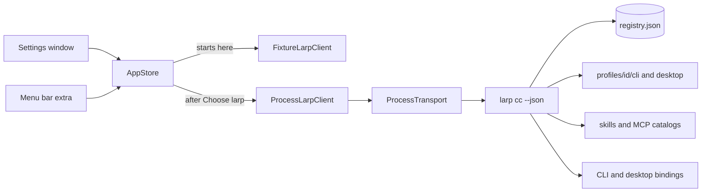
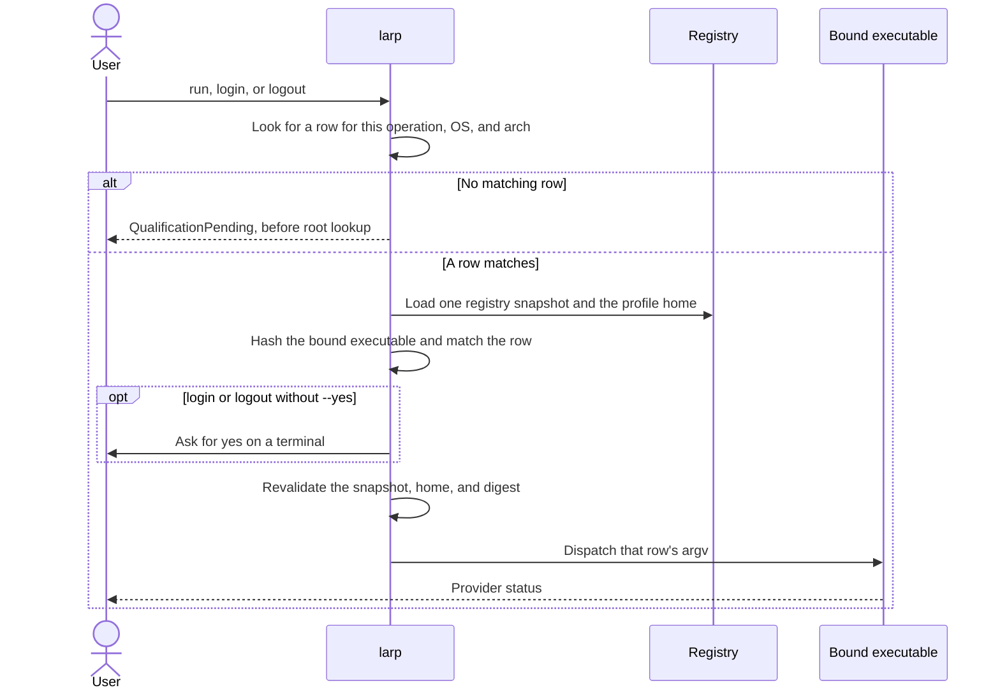
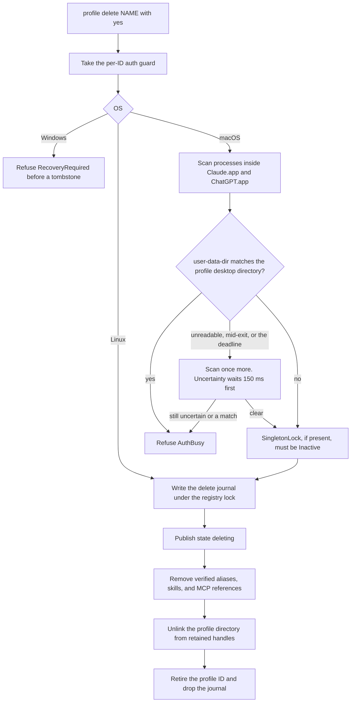

<!-- TODO(owner): logo pending. Expected files: docs/assets/larpcc-banner.svg and docs/assets/larpcc-banner-dark.svg (or .png). Replace this comment with the <picture> block. -->

<h1 align="center">LarpCC</h1>

<p align="center">
  <strong>Run Claude Code and Codex side by side, each account in its own profile.</strong>
  <br />
  <br />
  <a href="https://github.com/itsmrad/larpcc/issues"><strong>Issues</strong></a>
  &middot;
  <a href="#documentation">Documentation</a>
  &middot;
  <a href="#roadmap">Roadmap</a>
</p>

<p align="center">
  <a href="https://github.com/itsmrad/larpcc/actions/workflows/ci.yml"></a>
  <a href="https://github.com/itsmrad/larpcc/actions/workflows/macos-app.yml"></a>
  
  
</p>

> One person's own accounts only; LarpCC cannot guarantee a provider won't restrict an account.
>
> Use LarpCC only for your own accounts. Separate profiles are a convenience. Do not use them to share or resell accounts. LarpCC cannot guarantee that a provider will not restrict or suspend an account. Use it at your own risk and follow each provider's terms.

LarpCC is independent and is not affiliated with Anthropic or OpenAI.

## Table of contents

- [About the project](#about-the-project)
- [Built with](#built-with)
- [Architecture](#architecture)
- [Engineering facts](#engineering-facts)
- [Getting started](#getting-started)
- [Testing](#testing)
- [Repository structure](#repository-structure)
- [Documentation](#documentation)
- [Roadmap](#roadmap)
- [Contributing](#contributing)
- [Security](#security)
- [License](#license)
- [Acknowledgements](#acknowledgements)

## About the project

LarpCC keeps a named profile for each Claude Code or Codex account you use. A profile is a label plus an immutable numeric ID. The ID chooses the directories. Renaming keeps both the ID and the directory. Forgetting removes the registry record and keeps the directory. Deleting, on Linux and macOS, removes the managed profile directory after a safety scan and an explicit `--yes`.

The repository is a local CLI plus a macOS settings app. The MVP install path is macOS. The CLI also builds on Linux and Windows, with the closed and unsupported cases called out below. There is no hosted service.

What it does today:

- **Profiles, bindings, and surfaces.** [`larp cc profile`](crates/larpcc-cli/src/cli/mod.rs) adds, lists, shows, renames, and forgets profiles for `claude` and `codex`. Each profile has a CLI surface and a desktop surface (`profiles/<id>/cli` and `profiles/<id>/desktop`). [`larp cc provider bind`](crates/larpcc-cli/src/cli/mod.rs) records one absolute native executable per provider. `ok` means the path check passed. Binding does not run the executable, read its version, or qualify an account. See [stage 01](docs/stages/01-profiles.md) and [stage 04](docs/stages/04-layout-and-delete.md).
- **Launch stays closed.** `larp cc run`, `login`, and `logout` call [`admission::invoke`](crates/larpcc-cli/src/launch/admission.rs) with an empty operation table (`ROWS`). They refuse with `provider operation is disabled for this combination` before root lookup, registry access, provider probes, or process creation. Debug, release, installed, and all-features binaries use the same table. `--json` on those commands returns `json_native_io` before root IO. Account sign-in operations stay closed until a reviewed qualification row exists ([stage 03](docs/stages/03-account-qualification.md)).
- **Account status without a provider process.** `larp cc status NAME` reads profile metadata. While [`account::ROWS`](crates/larpcc-cli/src/account/mod.rs) is empty it reports `not_qualified` and does not run the provider. `status NAME --no-account` is the local metadata response, with `native_auth: not_observed`. See [stage 14](docs/stages/14-account-summary.md).
- **Delete, recover, and migrate.** On Linux and macOS, `profile delete NAME --yes` tombstones the profile, removes owned aliases and sharing references, then unlinks the profile directory through retained directory handles ([`delete_profile`](crates/larpcc-cli/src/registry/delete.rs)). `profile recover NAME --yes` resumes an interrupted delete. `profile migrate` moves empty legacy homes to the v3 layout on Linux and macOS. Windows `Profiles::open` returns `RecoveryRequired` before a tombstone or a tree move ([`platform/removal/windows.rs`](crates/larpcc-cli/src/platform/removal/windows.rs)). `--logout` requires a qualified native logout and is refused while that table is empty. Keychain items, remote grants, and Electron Safe Storage can remain after a directory is removed.
- **Aliases.** `larp cc alias` installs a copy of the running `larp` binary under `<data>/bin/NAME`, plus a receipt that pins the data root, profile ID, and surface ([stage 05](docs/stages/05-aliases.md)). Windows creation refuses with `AliasImageUnverified` because the loaded image cannot be verified ([`open_current_larp`](crates/larpcc-cli/src/platform/mod.rs)). An alias still has to pass the same empty launch table, so a CLI alias refuses at qualification. A desktop alias forwards to `app open`.
- **Skills and MCP catalogs.** Explicit skill packages and reference-only MCP server definitions can be shared across active CLI profiles, with per-profile switches ([stage 06](docs/stages/06-skills.md), [stage 07](docs/stages/07-mcp.md)). MCP definitions store command paths and environment-variable names, not secret values. Nothing in the skill importer executes the package.
- **Desktop apps.** On macOS, `larp cc app bind codex /Applications/ChatGPT.app` and `larp cc app open PROFILE` can launch or focus the official ChatGPT.app after signature checks ([`desktop/mod.rs`](crates/larpcc-cli/src/desktop/mod.rs), [stage 09](docs/stages/09-desktop.md)). Claude.app binding and open stay closed. Desktop dispatch on other operating systems returns `QualificationPending`. A dispatch receipt is a local launch or focus result, not a sign-in.
- **Local usage.** `larp cc usage` reads LOCAL limit records on Linux and macOS ([`usage/mod.rs`](crates/larpcc-cli/src/usage/mod.rs), [stage 11](docs/stages/11-usage.md)). LIVE syntax is reserved and returns `live_disabled`. Windows `usage`, usage settings changes, and `profile plan-label` exit 2 with `unsupported` before opening profile files. `settings usage` on Windows shows LOCAL mode and no profile data. Account status on Windows reports `usage: null`.
- **Doctor and JSON.** `larp cc doctor` reports local metadata. `--detect-versions` consults an empty descriptor table ([`provider/version.rs`](crates/larpcc-cli/src/provider/version.rs)), so it does not run a provider. `--json` emits one schema-1 envelope ([`docs/contracts/cli-v1.md`](docs/contracts/cli-v1.md)).
- **macOS app.** [`apps/macos`](apps/macos) is a SwiftUI Settings window and a menu bar extra. It starts in sample mode ([`FixtureLarpClient`](apps/macos/Sources/LarpCC/LarpCCApp.swift)). **General → larp executable → Choose…** switches that session to [`ProcessLarpClient`](apps/macos/Sources/LarpModel/ProcessLarpClient.swift), which runs `larp` with argument arrays and `--json`. The app's `usage` method still returns `commandUnavailable`, so a selected binary does not yet feed the usage views. Sample mode does. Themes are Tahoe, Sequoia, and Sonoma ([`Theme.swift`](apps/macos/Sources/LarpModel/Theme.swift)); Tahoe is drawn on macOS 26 and later.

## Built with

| Area | Technology |
| --- | --- |
| CLI | Rust 1.89 ([`rust-version`](Cargo.toml)), edition 2024, one crate [`larpcc-cli`](crates/larpcc-cli/Cargo.toml) |
| CLI parsing and data | [clap 4.6](https://github.com/clap-rs/clap), serde, serde_json, [sha2](https://github.com/RustCrypto/hashes) |
| Unix / Windows | libc on Unix; [windows-sys 0.61](https://github.com/microsoft/windows-rs) on Windows |
| macOS app | Swift 5.9, SwiftUI, AppKit, macOS 14+ ([`Package.swift`](apps/macos/Package.swift)). No third-party Swift packages |
| App boundary | Schema 1 JSON over a subprocess ([`cli-v1.md`](docs/contracts/cli-v1.md)) |
| Tests | `cargo test`, XCTest (`swift test` in [`apps/macos`](apps/macos)) |
| CI | [`.github/workflows/ci.yml`](.github/workflows/ci.yml) (`native` on Ubuntu, macOS, and Windows, plus `msrv` on Rust 1.89), [macOS App](.github/workflows/macos-app.yml), [macOS Snapshots](.github/workflows/macos-snapshots.yml) |

## Architecture

### App, CLI, and profile homes

The settings window and the menu bar extra share one `AppStore`. Sample mode never starts `larp`. After you choose a `larp` binary, the app sends argv arrays (no shell string) and decodes one schema-1 envelope per call. The CLI is the only writer of the registry, catalogs, and profile directories.



`ProcessLarpClient` is [`apps/macos/Sources/LarpModel/ProcessLarpClient.swift`](apps/macos/Sources/LarpModel/ProcessLarpClient.swift). Registry layout is [`docs/stages/04-layout-and-delete.md`](docs/stages/04-layout-and-delete.md).

### Launch admission

Ordinary `run`, `login`, and `logout` stop at the first box while `admission::ROWS` is empty. The later steps run only when a reviewed row matches this OS, architecture, operation, and executable digest. Synthetic tests inject invented rows into the same functions. They are not the installed `larp` binary.



`status NAME` is a different path. It opens the registry, and with an empty `account::ROWS` it returns `not_qualified` without calling `dispatch`. Desktop `app open` uses [`desktop::open_target`](crates/larpcc-cli/src/desktop/mod.rs): macOS only, and only unmodified `/Applications/ChatGPT.app`.

### Delete safety scan

`profile delete` on macOS scans the current user's processes before it publishes a tombstone. It considers executables inside `Claude.app` or `ChatGPT.app`, checks the vendor signature, and reads argv only to look for `--user-data-dir`. A match against the profile's desktop directory refuses the delete. Uncertainty waits 150 ms and scans once more. Each scan has a two-second deadline. Linux skips that process scan. Windows refuses when profile-tree handles are opened, before a tombstone.



The scan is [`delete/activity.rs`](crates/larpcc-cli/src/registry/delete/activity.rs). The transaction is [`delete.rs`](crates/larpcc-cli/src/registry/delete.rs) and [stage 04](docs/stages/04-layout-and-delete.md#delete-transaction-and-confined-removal). Close sessions you started outside Larp, including ones that set the provider home themselves, before you confirm. The scan is local hygiene. It is not a claim that every same-user process is visible or stopped.

## Engineering facts

A snapshot of git-tracked files at commit `e6aa0d44ae2de606f401bedb741f93d84897d9e4` (2026-11-24). These numbers drift as the code changes. Regenerate them with the commands under the table.

| Metric | Value |
| --- | --- |
| Rust files that contain `#[test]` | 58 |
| Rust `#[test]` functions | 388 |
| Swift test files (`apps/macos/Tests`) | 7 |
| Swift test methods (`func test…`) | 49 |
| Workspace crates | 1 (`larpcc-cli`) |
| Stage documents (`docs/stages`) | 13 |
| CI workflow jobs | `native` (Ubuntu, macOS, Windows) and `msrv` (Rust 1.89) |
| macOS workflow jobs | `native-app`, `snapshots` |
| Rust lines in `crates/larpcc-cli/src` | 28,801 |
| Rust lines in `crates/larpcc-cli/tests` | 11,436 |
| Swift lines in `apps/macos/Sources` | 5,585 |
| Swift lines in `apps/macos/Tests` | 860 |
| Shell lines in `scripts` | 353 |
| Shell lines in `apps/macos/scripts` | 163 |

`crates/larpcc-cli/src` includes inline tests. The line counts are `wc -l` on git-tracked `.rs`, `.swift`, and `.sh` files.

<details>
<summary>How these numbers were computed</summary>

Run from the repository root at commit `e6aa0d44ae2de606f401bedb741f93d84897d9e4` (2026-11-24). Counts include only files tracked by git.

```bash
git rev-parse HEAD
git log -1 --format='%cs'

git ls-files '*.rs' | while read -r f; do
  grep -qE '^[[:space:]]*#\[test\]' "$f" && echo "$f"
done | wc -l

git ls-files '*.rs' | xargs grep -hcE '^[[:space:]]*#\[test\]' | awk '{s+=$1} END {print s}'

git ls-files 'apps/macos/Tests/**/*.swift' | wc -l
git ls-files 'apps/macos/Tests/**/*.swift' \
  | xargs grep -hcE '^[[:space:]]*func test[A-Za-z0-9_]*\(' | awk '{s+=$1} END {print s}'

git ls-files 'crates/*/Cargo.toml' | wc -l
git ls-files 'docs/stages/*.md' | wc -l

for a in crates/larpcc-cli/src crates/larpcc-cli/tests apps/macos/Sources apps/macos/Tests apps/macos/scripts scripts; do
  git ls-files "$a" | grep -E '\.(rs|swift|sh)$' | xargs wc -l | tail -1
done
```

CI job names are the keys under `jobs:` in [`.github/workflows/ci.yml`](.github/workflows/ci.yml), [`.github/workflows/macos-app.yml`](.github/workflows/macos-app.yml), and [`.github/workflows/macos-snapshots.yml`](.github/workflows/macos-snapshots.yml).

</details>

## Getting started

### Prerequisites

- macOS 14 or newer for the app and [`scripts/install-macos.sh`](scripts/install-macos.sh)
- Rust 1.89 or newer (`rust-version` in [`Cargo.toml`](Cargo.toml))
- Apple's Swift build tools, Swift 5.9 or newer, to build the app ([`Package.swift`](apps/macos/Package.swift))

The CLI crate itself builds on Linux and Windows. Profile-tree delete, legacy migration, desktop app open, and `usage` are not available on every OS. See [Command behavior](#command-behavior).

### Install on macOS (local, unsigned)

From the repository root, preview and run the installer.

```sh
./scripts/install-macos.sh --dry-run
./scripts/install-macos.sh
```

The installer uses `~/.local/bin/larp` and `~/Applications/LarpCC.app`.
Use `--prefix /absolute/path/to/bin` to choose another directory for `larp`. The
installation paths must be free of symlinks. The installer recognizes a previous
`larp` by its matching SHA-256 extended attribute. To replace any other file
named `larp`, move it aside or explicitly pass `--replace`. The installer keeps
every replaced binary and app in timestamped backup directories beside the
install targets. It verifies both installed targets before reporting success
and prints the backup paths even if verification fails. Move those directories
to the Trash when you no longer need them.

Add the chosen directory to `PATH` if needed. In LarpCC, use **General → larp
executable → Choose…** to select the installed binary.

To build and install manually with the default paths, run these commands from
the repository root.

```sh
cargo build --release --locked --bin larp --target-dir "$PWD/target"
./apps/macos/scripts/bundle.sh
mkdir -p -m 0755 "$HOME/.local/bin" "$HOME/Applications"
```

For a manual upgrade, move the existing `larp` aside first. The following
commands require an unused destination and mark the new binary for future
installer upgrades.

```sh
larp_bin="$HOME/.local/bin/larp"
test ! -e "$larp_bin" && test ! -L "$larp_bin" &&
  install -m 0755 target/release/larp "$larp_bin" &&
  larp_hash=$(shasum -a 256 < "$larp_bin") &&
  xattr -w dev.larpcc.installer.sha256 "${larp_hash%% *}" "$larp_bin"
```

Quit any running LarpCC settings app. If you already installed LarpCC, move the
old `~/Applications/LarpCC.app` to the Trash in Finder. Then copy the new bundle.

```sh
ditto apps/macos/dist/LarpCC.app "$HOME/Applications/LarpCC.app"
export PATH="$HOME/.local/bin:$PATH"
```

If macOS blocks your self-built unsigned app due to quarantine, you can clear
the quarantine attribute for that bundle.

```sh
xattr -dr com.apple.quarantine "$HOME/Applications/LarpCC.app"
```

### Known limitations

The installer assumes no other process modifies the install destinations while
it runs. Wait for the installer to finish before moving, editing, or replacing
either target or its parent directory.

### Uninstall

Quit LarpCC. Remove the `larp` file you installed from your chosen prefix and
move the installed `~/Applications/LarpCC.app` to the Trash. Keep the profile data
directory (`LARPCC_HOME` or `~/Library/Application Support/larpcc`).

### Command-line use

Requires Rust 1.89 or newer:

```sh
cargo build --release --locked --bin larp
cargo install --path crates/larpcc-cli --locked --bin larp
larp --version
larp cc profile --help
```

`cargo install` and `cargo build --release --bin larp` do not enable `synthetic-launch`. That feature builds test-only driver and fake binaries. It is not a release artifact.

#### Profiles and providers

```sh
larp cc profile add work --provider claude
larp cc profile add personal --provider codex
larp cc profile list
larp cc profile show work
larp cc profile surface work desktop on
larp cc profile list --json
larp cc profile rename work job --expected-revision 3
larp cc profile forget personal --yes
larp cc profile delete personal --yes
larp cc profile recover personal --yes
larp cc profile migrate
larp cc provider bind claude /absolute/path/to/native-executable
larp cc provider list
larp cc provider evidence claude
```

#### Skills, MCP, aliases, desktop, usage, doctor

```sh
larp cc skills add /absolute/path/to/package --name example
larp cc skills list
larp cc skills matrix
larp cc skills disable example claude-work
larp cc skills enable example claude-work
larp cc skills sync
larp cc skills remove example

larp cc mcp add example --command /absolute/path/to/server
larp cc mcp list
larp cc mcp matrix
larp cc mcp enable example claude-work
larp cc mcp disable example claude-work
larp cc mcp sync
larp cc mcp remove example

larp cc alias add codex-45 claude-work
larp cc alias add work-app codex-45 --desktop
larp cc alias add claude claude-work --shadow
larp cc alias list
larp cc alias remove codex-45

larp cc app bind codex /Applications/ChatGPT.app --version LABEL
larp cc app open PROFILE
larp cc usage
larp cc settings usage
larp cc doctor
larp cc doctor --detect-versions
larp cc status work
larp cc status work --no-account
```

`run`, `login`, and `logout` are in the grammar and refuse until qualification rows exist:

```sh
larp cc run work
larp cc login work --yes
larp cc logout work --yes
```

### Command behavior

Names contain 1–32 lowercase ASCII letters, digits, hyphens, or underscores, and start with a letter. `larp` and Windows device names are reserved on all platforms. New profile names and rename destinations reserve `larp`. Existing legacy profiles with that name stay readable. Providers are exactly `claude` and `codex`.

Help and version exit 0. Usage errors and a rebind without `--replace` exit 2. Local operational failures exit 1. Human errors go to stderr. Reading a missing registry does not create it.

`--json` is global, before a child `--` separator. It writes one schema-1 envelope to stdout, with empty stderr, and exits 0, 1, or 2. Errors use fixed messages and omit the values you typed and raw OS errors. Help and version do no root IO.

Registry commands accept `--expected-revision REV`. The registry lock compares that revision before name resolution. A stale revision returns `conflict`. Receipts contain the committed revision and the immutable ID. Repeating a surface setting is a no-op: JSON reports `changed: false` and the revision stays the same. Failed operations and binding no-ops do not increment the revision. Registry and JSON envelopes are limited to 1 MiB.

The data root is non-empty `LARPCC_HOME`, otherwise:

| OS | Default root |
| --- | --- |
| Linux | `$XDG_DATA_HOME/larpcc` when that path is absolute; otherwise `$HOME/.local/share/larpcc` |
| macOS | `$HOME/Library/Application Support/larpcc` |
| Windows | `%LOCALAPPDATA%\larpcc` |

The root must be absolute, with no `..` component, and its immediate parent must exist. Metadata is `registry.json`, `registry.lock`, a transient `registry.json.tmp`, and `profiles/<id>/{cli,desktop}`. New roots use schema v3. CLI defaults on and desktop off. Toggling a surface does not qualify native launch. JSON profile list and show include both surfaces, the provider, lifecycle state, aliases, and desktop bindings.

Existing v1 and v2 registries stay readable. Mutations that need v3 refuse `recovery_required` until `profile migrate`. That command upgrades registries whose legacy homes are empty, on Linux and macOS. Keep older Larp binaries and native sessions stopped while migrating. Windows refuses legacy profile-tree moves. An interrupted migration can need the manual steps in [v2 migration](docs/stages/04-layout-and-delete.md#v2-migration-transaction). No old profile directory is copied or adopted on its own. `forget` still keeps the folder and refuses while aliases, sharing references, or a tombstone exist.

Close sessions that use a profile before `delete` or `recover`, including sessions started outside Larp. On Linux and macOS, delete removes the managed profile directory and owned aliases, clears sharing references, and retires the profile ID. If it is interrupted, resume with `profile recover NAME --yes`. A pending journal blocks other registry commands. Windows refuses profile-tree deletion and recovery until confined removal exists. `--logout` requires native qualification. Keychain items, remote grants, and Electron Safe Storage may remain.

On Windows, `larp cc usage` and usage settings changes, including `profile plan-label`, exit 2 with `unsupported` before opening files. `larp cc settings usage` shows LOCAL mode with no profile data. Account status reports `usage: null`. See [stage 11](docs/stages/11-usage.md). On Linux and macOS, usage reads are LOCAL. `--live` returns `live_disabled` after the arguments parse. A settings file that already says LIVE is reported as `needs_acknowledgement` and is left unchanged.

A skill package needs `SKILL.md` and portable ASCII relative filenames. Trusted `0755` and `0644` sources are accepted. Symlinks, reparse points, hardlinks, special files, unsafe ancestry, and case-insensitive collisions refuse. Limits are 1,000 files, 16 MiB, and 16 path levels, with at most 1,000 directories. Nothing executes. Sources that are the managed or vendor home, or that contain or sit inside one, are refused by directory identity before the package is read. Dot entries, `auth.json`, `*.pem`, and `id_*` names at any depth refuse the whole package before those entries are read. The package is copied once into `shared/skills/<name>` and checked with a canonical SHA-256 digest. Existing store entries and occupied profile destinations are never replaced. Unix uses in-store symlinks. Windows uses owned digest copies because confined junction creation is unavailable. New active CLI profiles inherit all skills. Explicit disables stay with the immutable profile ID across renames. Remove requires every active profile reference to be disabled first.

`skills.json` is a bounded version-1 catalog. `owned-files.json` records artifact identities and digests. Both use the registry lock. A bounded `share-journal.json` keeps the package bytes and the mutation plan until the index, manifest, and registry commit finish. `skills sync` resumes a pending journal. Sharing writes take per-profile lifecycle guards before the registry lock. Contention refuses. Cleanup unlinks verified leaves. It does not traverse a link target and it does not use recursive directory removal.

`--json` on skills commands is schema 1. List and matrix are read-only. Mutations and reads accept `--expected-revision` under the same registry lock, before name resolution. JSON contains metadata and switches, never package contents.

An alias is a copy of the running, trusted `larp` at `<data>/bin/NAME` (`NAME.exe` on Windows) plus `NAME.larp-alias.json`. The receipt pins the absolute data root, the profile ID, the surface, and the SHA-256 of the launcher and its source. The registry keeps its own receipt digest. Windows alias creation refuses because the loaded image cannot be verified. Any valid profile name works for either provider. `claude` and `codex` require `--shadow`. An existing file at the alias path, or a same-named command on `PATH` when `--shadow` is absent, refuses. LarpCC prints guidance and does not edit `PATH` or shell startup files.

An alias-named launcher uses its receipt to select the root. A copy that is named and invoked as `larp` uses the ambient root, ignores an adjacent receipt, and parses the `cc` grammar. Alias arguments, including a literal `--json`, are forwarded to `run`, so the qualification refusal still applies. A desktop alias forwards to `app open` and takes no arguments. Renaming the profile keeps the mapping. `profile forget` refuses while an alias references the profile. Moved, copied, or modified launchers, forged receipts, and a newer `larp` (reported `incompatible`) refuse. Add and remove use the registry lock and `share-journal.json` with kind `alias`. An interrupted add rolls back. An interrupted remove completes. Remove deletes only artifacts proven by digest and identity. See [manual alias recovery](docs/stages/05-aliases.md#manual-alias-recovery).

`provider bind … --replace` changes a binding. An identical binding is a no-op, even if the executable has since disappeared. `provider list` revalidates paths and reports `ok`, `unbound`, or `invalid: …`. `ok` is path validation only. Binding never runs an executable. Paths and diagnostics escape terminal controls and the specified Unicode format controls. Profile list sorts by name and reports each home as `ok`, `missing`, or `unsafe`. Unsafe or missing homes can still be renamed or forgotten. `forget` requires `--yes` and never deletes a home.

On macOS, bind the verified official ChatGPT.app with `app bind codex /Applications/ChatGPT.app [--version LABEL]`, enable the Codex profile's desktop surface with `profile surface PROFILE desktop on`, then run `app open PROFILE`. Unrecognized app versions warn and may launch after the same admission checks. JSON dispatch reports the local launch or focus outcome. Claude.app, and desktop open on other operating systems, stay closed. CLI qualification rows stay empty.

On Unix, managed objects must be owned by the current user and must not grant group or other access. Ancestors must be owned by root or the current user, without group or other write, including sticky directories such as `/tmp`. New files are `0600` and new directories are `0700`. macOS requires a successful descriptor security query. An absent ACL property is accepted. Extended allow ACLs and query errors are refused, with no repair. The x86_64 ACL ABI branch is not native-qualified. Unsafe lock or temp objects block reads and writes. Safe stale temp files are ignored by reads and removed only after a successful write preflight. Provider directory contents are never inspected for this check.

Native binding checks reject scripts, unsafe ownership, permissions, and ancestry, data-root containment, and Larp's own filesystem identity. Unix installation symlinks are resolved through a bounded trusted chain, and the resolved target is what gets recorded. A file header does not prove architecture or provenance. On Windows, Larp creates managed objects with protected ACLs and checks existing owners, ACLs, and reparse points before use. Unsafe paths are refused without changing permissions or copying provider data. Windows support is not advertised as a finished desktop product.

Use a local filesystem. Advisory locks coordinate Larp writers. NFS and SMB locking is unsupported. Opened metadata handles are validated before data reads. Unix atomic replacement and directory sync depend on the filesystem. A same-user or privileged writer can still race a path check and a later execution. There is no identity-pinned execution sandbox. On WSL, use a Linux path rather than `/mnt/c`.

Checks use synthetic data and native test helpers. `LARPCC_TEST_PARENT` must be an existing private parent with trusted ancestry. It affects test fixtures only. CI provisions a private per-run parent and runs the native Linux, macOS, and Windows tests plus the Ubuntu Rust 1.89 gate.

```sh
cargo fmt --all -- --check
cargo clippy --workspace --all-targets --locked -- -D warnings
cargo test --workspace --locked
cargo test --workspace --features synthetic-launch --target-dir /absolute/private/build-parent/synthetic-target --locked
cargo test --bin larpcc-synthetic --features synthetic-launch --target-dir /absolute/private/build-parent/synthetic-target --locked
cargo +1.89 test --workspace --locked
```

The `synthetic-launch` feature builds separate test-only driver and fake binaries. Invented rows exercise the same bounded executable SHA-256, snapshot revalidation, and metadata admission as ordinary dispatch. They do not describe an admitted vendor interface. Unix `run` uses direct `execve`. Synthetic authentication and status use a short-lived foreground wrapper that holds a per-ID cooperative lock until the direct child is reaped. Registry locks do not span confirmation or the child lifetime. These checks do not exclude a direct native client or a surviving descendant. A parent `SIGKILL` or an OS crash can release the cooperative lock while a child is still running. After an abnormal exit, stop those sessions yourself before delete or recover. There is no shell fallback and no background manager. Only fake operations are exercised. No installed provider, credential store, or account is accessed. Native operation rows remain empty.

Remote host commands from [stage 13](docs/stages/13-remote-hosts.md) are not in this build. `--expected-host-revision` returns `unsupported` with `Host revision preconditions require remote routing, which is unavailable.`

## Testing

| Layer | Tool | Where | Run |
| --- | --- | --- | --- |
| CLI unit and integration | `cargo test` | `crates/larpcc-cli` | `cargo test --workspace --locked` |
| CLI MSRV | Rust 1.89 | same | `cargo +1.89 test --workspace --locked` |
| Synthetic admission | `synthetic-launch` | nonpackaged `larpcc-synthetic` and fakes | see the commands above |
| macOS model and UI | XCTest | [`apps/macos/Tests`](apps/macos/Tests) | `swift test` from `apps/macos` |
| Unsigned app bundle | `bundle.sh` | [`apps/macos/scripts/bundle.sh`](apps/macos/scripts/bundle.sh) | `./apps/macos/scripts/bundle.sh` |
| Manual Mac checklist | the guide | [`docs/mvp-test-guide.md`](docs/mvp-test-guide.md) | only after a lead fills the handoff |

CI ([`.github/workflows/ci.yml`](.github/workflows/ci.yml)) runs fmt (Linux), clippy, tests, a release build of `larp`, the all-features gate test, and the synthetic-launch tests on Ubuntu, macOS, and Windows. The `msrv` job repeats the suite on Rust 1.89. [macOS App](.github/workflows/macos-app.yml) compares the bundled JSON schema with [`docs/contracts`](docs/contracts), runs `swift test`, and builds an unsigned bundle when the app or the contract changes. [macOS Snapshots](.github/workflows/macos-snapshots.yml) renders sample-data pages on macOS 26. It does not sign in to a provider.

[`docs/mvp-test-guide.md`](docs/mvp-test-guide.md) is a human checklist for two disposable profiles. It starts only after the test handoff names an approved build. In this tree, `run`, `login`, and `logout` still refuse because the qualification table is empty.

## Repository structure

```text
.
├── crates/larpcc-cli/          # the larp binary
│   └── src/
│       ├── cli/                # clap grammar, JSON, doctor
│       ├── launch/             # admission; ROWS is empty
│       ├── registry/           # profiles, aliases, delete, migrate
│       ├── share/              # skills and MCP catalogs
│       ├── usage/              # LOCAL usage; LIVE disabled
│       ├── desktop/            # ChatGPT.app on macOS; Claude.app closed
│       ├── account/            # status; account ROWS is empty
│       └── platform/           # Unix and Windows filesystem checks
├── apps/macos/                 # SwiftUI Settings app and menu bar extra
│   ├── Sources/LarpCC/         # windows, pages, themes
│   ├── Sources/LarpModel/      # JSON client and process bridge
│   └── Tests/                  # XCTest
├── scripts/install-macos.sh    # local unsigned install
├── docs/
│   ├── stages/                 # stage contracts 01–11, 13, 14
│   └── contracts/              # CLI JSON schema and threat review
├── plan.md                     # current plan and historical context
└── .github/workflows/          # ci.yml, macos-app.yml, macos-snapshots.yml
```

## Documentation

| Document | Contents |
| --- | --- |
| [plan.md](plan.md) | Current requirements, the usage exception, and slice order |
| [docs/contracts/cli-v1.md](docs/contracts/cli-v1.md) | Schema-1 JSON envelopes the app decodes |
| [docs/contracts/cli-v1.schema.json](docs/contracts/cli-v1.schema.json) | JSON Schema for those envelopes |
| [docs/contracts/threats.md](docs/contracts/threats.md) | Threat review for delete, MCP, desktop, and remote |
| [docs/stages/01-profiles.md](docs/stages/01-profiles.md) | Profile records and the data root |
| [docs/stages/02-native-launch.md](docs/stages/02-native-launch.md) | Native path and permission checks |
| [docs/stages/03-account-qualification.md](docs/stages/03-account-qualification.md) | Empty qualification table for run, login, and logout |
| [docs/stages/04-layout-and-delete.md](docs/stages/04-layout-and-delete.md) | v3 layout, migrate, delete, and recover |
| [docs/stages/05-aliases.md](docs/stages/05-aliases.md) | Alias launchers and receipts |
| [docs/stages/06-skills.md](docs/stages/06-skills.md) | Shared skill packages |
| [docs/stages/07-mcp.md](docs/stages/07-mcp.md) | Reference-only MCP catalog |
| [docs/stages/08-json-launch-doctor.md](docs/stages/08-json-launch-doctor.md) | JSON, doctor, and version probes |
| [docs/stages/09-desktop.md](docs/stages/09-desktop.md) | macOS ChatGPT.app dispatch |
| [docs/stages/10-native-gui.md](docs/stages/10-native-gui.md) | SwiftUI consumer of CLI JSON |
| [docs/stages/11-usage.md](docs/stages/11-usage.md) | LOCAL usage, disabled LIVE, Windows refusal |
| [docs/stages/13-remote-hosts.md](docs/stages/13-remote-hosts.md) | SSH hosts; contract only in this tree |
| [docs/stages/14-account-summary.md](docs/stages/14-account-summary.md) | Status email and plan, once a row exists |
| [docs/mvp-test-guide.md](docs/mvp-test-guide.md) | Manual Mac test, after a filled handoff |
| [apps/macos/README.md](apps/macos/README.md) | Sample mode, page list, and how the app selects `larp` |

## Roadmap

Shipped behavior is the list in [About the project](#about-the-project). These items are specified and still closed in this tree:

- Reviewed qualification rows for `run`, `login`, `logout`, and account `status` ([stage 03](docs/stages/03-account-qualification.md), [stage 14](docs/stages/14-account-summary.md)). The compiled tables are empty.
- Claude.app bind and open ([stage 09](docs/stages/09-desktop.md)). ChatGPT.app on macOS is the desktop path that can open.
- LIVE usage against a real account. The CLI returns `live_disabled`. The app does not call `larp cc usage` yet ([`ProcessLarpClient.usage`](apps/macos/Sources/LarpModel/ProcessLarpClient.swift)).
- Windows profile-tree delete, recovery, and legacy migration, Windows `usage`, and Windows alias creation.
- Remote hosts over SSH ([stage 13](docs/stages/13-remote-hosts.md)). `--expected-host-revision` is refused.
- Reviewed version-probe descriptors for `doctor --detect-versions`. The table is empty.
- A chosen license, signing, and distribution. The macOS installer produces a local unsigned app.

[plan.md](plan.md) is the planning record. It is not a promise that a later slice is already in the binary.

## Contributing

There is no contributing guide in this repository. Issues and pull requests go to [github.com/itsmrad/larpcc](https://github.com/itsmrad/larpcc/issues). CI in [`.github/workflows/ci.yml`](.github/workflows/ci.yml) is the check a change has to pass. Keep claims in docs aligned with the code they cite.

## Security

There is no security policy file in this repository. Report a vulnerability privately to the repository owner. Do not put credentials, tokens, or account details in a public issue.

LarpCC does not claim that a provider will allow multiple profiles. The notice at the top of this file is the boundary: one person's own accounts, and no guarantee against a restriction. Native `run`, `login`, and `logout` stay disabled until qualification rows are reviewed. The threat notes that match the current design are in [docs/contracts/threats.md](docs/contracts/threats.md).

## License

<!-- TODO(owner): choose a license -->

No license has been chosen yet. There is no `LICENSE` file in this repository.

## Acknowledgements

LarpCC is built with Rust, SwiftUI, [clap](https://github.com/clap-rs/clap), serde, and the RustCrypto `sha2` crate. Claude Code is a product of Anthropic. Codex and ChatGPT are products of OpenAI. LarpCC is independent and is not affiliated with either.
